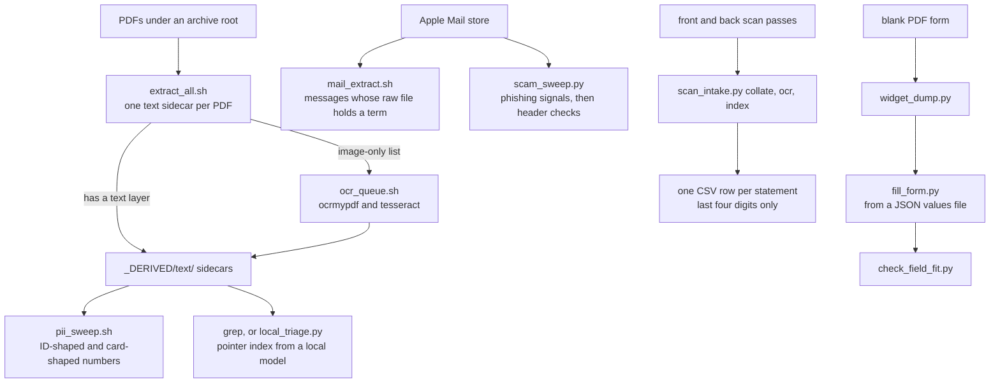

# Local document and mail tooling (macOS)

Small command-line tools for working through a large personal archive of PDFs, scanned paper and
Apple Mail on a Mac. The document and mail tools run locally and call no web service.

The archive this was built for is private, and much of the work on it is done by an AI assistant
running on the owner's Mac. So the tools share a few habits, and each habit is code and not a line in
a manual: they write their own output files and leave their inputs alone; the main sweeps stop on
zero input or run a canary before they report; `extract_all.sh` and `mail_extract.sh` say what they
could not read; `.gitignore` keeps the usual machine-readable outputs out of this repository; and
`pii_guard.sh` fails on four personal-data patterns in tracked files when it is run. `docs/DESIGN.md`
gives the failure each tool exists to prevent and the known limits of each; `docs/SAFETY.md` gives the
guard rails.

## What it does

- give every PDF a searchable text file, and OCR the scans (`local_pipeline/`)
- check a redaction for ID-shaped and card-shaped numbers
- read the Apple Mail store directly, and sweep it for phishing
- build a pointer index with an Ollama model (loopback by default)
- inspect, fill and check PDF forms (`pdf_forms/`)
- turn a stack of scanned paper statements into one CSV (`scan_intake/`)

Two utilities in `tools/` do reach outside the machine, by design: `backup_repo_bundle.sh` copies a git
bundle to a backup folder you name (which may be one that syncs to a cloud), and `datecheck.sh` reads
the `Date` header of a few public websites. The two local-model tools send text to the address in
`OLLAMA_URL`, which defaults to loopback. Sending text to a non-loopback HTTP Ollama server requires
`OLLAMA_ALLOW_REMOTE=1`; HTTPS endpoints are allowed without that opt-in.

`TOOL_INDEX.md` lists every tool in one line each. The header of each file gives its usage and, where
they apply, the environment variables it reads and what it needs installed.

## How the pieces fit



The four groups are independent. Each tool is one short script. Three files are shared: `env.sh`
by `extract_all.sh` and `ocr_queue.sh`, `tools/stamp.sh` by the folder diff and the census, and
`vision_ocr.py`, which `vision_ocr_one.py` imports.

## Design rules

| rule | where it shows |
|---|---|
| A sweep proves that it ran, or shows how much it looked at | `extract_all.sh`, `ocr_queue.sh` and `mail_extract.sh` stop on zero input; `pii_sweep.sh` and `local_triage.py` run a canary with a known answer first and stop if it does not fire; `scam_sweep.py` prints the number of messages it scanned and `drive_folder_diff.py` the number of files in each tree, so a zero is visible |
| An unread document is not a negative | image-only PDFs are listed and counted, within the limits given in `docs/DESIGN.md`; `mail_extract.sh` ends its report with what it did not search |
| Sources are read, never changed | the extractors, the mail tools and the folder diff do not write to their inputs; `ocr_queue.sh` writes its text and its OCR copy under `_DERIVED/` |
| A local model points, it does not decide | `local_triage.py` writes pointer cards, not summaries; `ask_local.sh` follows every answer with a reminder to open the source |
| A backup is proven by restoring it | `backup_repo_bundle.sh` clones its own bundle before copying it, unless told to skip that; `restore_test_bundle_chain.sh` replays a chain of bundles into a scratch clone |
| A timestamp is read, not typed | `stamp.sh` prints the clock for log lines; `datecheck.sh` shows it next to the `Date` header of public sites |
| Private values stay out of reports where they can, and out of this repo always | the statement index of `scan_intake.py` holds only the last four digits of an account number; `.gitignore` and `pii_guard.sh` guard the repo |

## Quick start

```bash
git clone https://github.com/mohamedchizari/local-document-tooling.git
cd local-document-tooling

# 1. text for every PDF under a folder (needs poppler; see local_pipeline/env.sh)
bash local_pipeline/extract_all.sh ~/archive

# 2. OCR the scans it listed (needs ocrmypdf and tesseract).
#    It asks before it starts; OCR_YES=1 skips the question, for a run with no keyboard.
bash local_pipeline/ocr_queue.sh ~/archive

# 3. search is now a grep over text files
grep -ril "some term" ~/archive/_DERIVED/text

# 4. check a redaction: ID-shaped and card-shaped numbers in the sidecars
bash local_pipeline/pii_sweep.sh ~/archive
```

Sidecars, logs, reports and OCR copies go under `~/archive/_DERIVED/` (OCR staging files go to
`~/.ocrtmp`; see `local_pipeline/env.sh`). The PDFs themselves are not touched.

## Requirements

macOS for the Mail and Vision tools; the PDF text pipeline and the form tools also run on Linux.
bash 3.2 or later and Python 3.9 or later. Depending on the tool: poppler (`pdftotext`, `pdfimages`),
tesseract and ocrmypdf, the `sqlite3` command-line tool, `curl`, `git`, Ollama, and the Python packages
`pypdf`, `reportlab` and `pyobjc-core`. The check script also needs Pillow.

## Privacy

The tools read private documents and write reports about them. Some reports contain the very numbers
they look for, and others list senders and subjects. Write reports outside this repo.

`.gitignore` keeps the usual outputs out if one lands here anyway: PDFs, mail files, JSON other than the
example config, TSV, CSV, JSONL, bundles and the `_DERIVED/` folder. It does not cover Markdown or
plain-text outputs (reports, OCR sidecars written beside a scan), so do not point a tool's output here.

`tools/pii_guard.sh` fails when a tracked file carries a home-directory path, a hyphenated 3-2-4 digit
ID, a run of 13 to 19 digits or a real email address. Run it before every push; a git pre-push hook that
calls it is the easy way (`docs/SAFETY.md` has the two lines). It is a tripwire for four patterns. It
does not see names, addresses, phone numbers or prose that says too much, it skips lines marked
`pii-guard: allow`, and it reads the working-tree copies of tracked files, not the commits being pushed.

## Known limits

- The phishing sweep scores on sender and subject only and is tuned for recall of obvious cases; treat
  its output as a list to look at.
- The form filler estimates text width from character counts; `check_field_fit.py` measures in Helvetica.
- `tests/run_checks.sh` checks the PDF text pipeline and the amount patterns of `scan_intake.py`
  against generated fixtures and runs focused regression tests for selected reliability fixes.
  Remaining behavior was checked by hand on macOS, and several tools also on Linux.
  `docs/DESIGN.md` says what was run.
- `extract_all.sh` judges a PDF as a whole. A PDF that mixes text pages and scanned pages passes, and
  its scanned pages stay unread.
- `docs/DESIGN.md` lists the other known limits, tool by tool.

## More

- `docs/DESIGN.md`: each tool, the failure it exists to prevent, what it checks about itself, and its known limits
- `docs/SAFETY.md`: the guard rails, and why they are built into the tools
- `CONTRIBUTING.md`: what a change has to keep true
- `tests/run_checks.sh`: the checks for the PDF pipeline and the statement amounts
- `TOOL_INDEX.md`: one line per tool

## License

MIT. See `LICENSE`. Written by Mohamed Chizari, Seven Sky Consulting.
